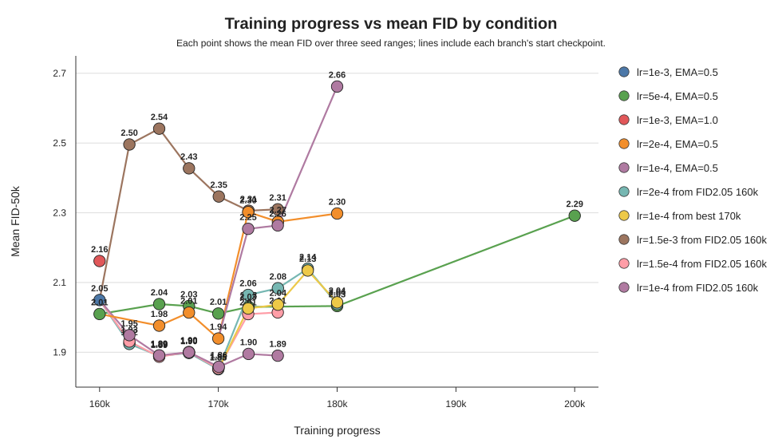

# EDM CIFAR-10 class-conditional における 160k以降の最適学習条件の模索

## 目的

120k以降でFIDが悪化する傾向があったため、160k checkpointを起点として learning rate と EMA half-life を変更し、FIDの挙動を確認しつつ最適な学習条件を見つける。

## 結果

新しい実験17・18までを含めても、現時点で最良の結果は `lr=0.001, EMA=0.5` で到達した160k checkpointから、`lr=0.0002, EMA=0.5` に下げて継続した `170000` snapshot であり、FID平均は `1.85124` だった。

これは、これまで最良としていた別runの `lr=0.0002, EMA=0.5` 170k checkpoint、FID平均 `1.93936` を上回る。したがって、単に160k以降の learning rate を下げるだけでなく、160k時点の起点checkpointと、その後の学習軌道が重要である可能性が高い。

実験11では、`lr=0.0005, EMA=0.5` のまま170k周辺を細かく評価したが、最良は170035の FID平均 `2.01113` であり、実験10の `1.85124` には届かなかった。つまり、170k周辺で細かく見ても、`lr=0.0005` 継続では大きな改善は見られなかった。

実験10では `162509 -> 165018 -> 167526 -> 170000` と進むにつれて、FID平均が `1.92373 -> 1.88942 -> 1.89796 -> 1.85124` となった。途中で小さい揺れはあるが、170000が最良だった。

実験12では、この170000 checkpointから同じ `lr=0.0002, EMA=0.5` で180kまで継続した。結果は `172509: 2.06431`, `175018: 2.08354`, `177526: 2.13972`, `180000: 2.03784` であり、170000以降は明確に悪化した。

実験13では、同じ170000 checkpointから `lr=0.0001, EMA=0.5` に下げて180kまで継続した。しかし `172509: 2.02557`, `175018: 2.03641`, `177526: 2.13456`, `180000: 2.04304` となり、learning rate をさらに下げても170k以降の悪化は避けられなかった。

実験14では、FID 2.05程度の160k checkpointから `lr=0.0015, EMA=0.5` で175kまで継続したが、FID平均は `2.30-2.54` 程度で大きく悪化した。160k以降に learning rate を上げる方向は適さないと考えられる。

実験16では、同じFID 2.05程度の160k checkpointから `lr=0.00015, EMA=0.5` で170kまで継続した。FID平均は `162509: 1.93085`, `165018: 1.88729`, `167526: 1.90077`, `170000: 1.85363` であり、実験10の `lr=0.0002` と非常に近い挙動を示した。ただし最良値は実験10の `1.85124` にわずかに届かなかった。

実験17では、実験16の170000 checkpointから同じ `lr=0.00015, EMA=0.5` で175kまで継続した。結果は `172509: 2.00938`, `175000: 2.01434` であり、170k以降の継続でFIDが悪化した。

実験18では、同じFID 2.05程度の160k checkpointから `lr=0.0001, EMA=0.5` で175kまで継続した。FID平均は `162509: 1.94893`, `165018: 1.89113`, `167526: 1.89994`, `170035: 1.85841`, `172544: 1.89526`, `175000: 1.89012` であり、`lr=0.00015` や `lr=0.0002` と同様に170k付近で良くなるが、最良値は実験10・16には届かなかった。

## 学習条件ごとのFID平均

図は、160k以降の各学習条件について、横軸をtraining progress、縦軸を3 seed範囲のFID平均として整理したものである。実験10-18の追加評価点も含めて更新した。

| 学習条件 | 評価時点 | FID平均 |
|---|---:|---:|
| lr=0.001, EMA=0.5 | 160k | 2.04986 |
| lr=0.001, EMA=1.0 | 160k | 2.16162 |
| lr=0.0005, EMA=0.5 | 160k | 2.00962 |
| lr=0.0005, EMA=0.5 | 165018 | 2.03798 |
| lr=0.0005, EMA=0.5 | 167526 | 2.03267 |
| lr=0.0005, EMA=0.5 | 170035 | 2.01113 |
| lr=0.0005, EMA=0.5 | 172544 | 2.03004 |
| lr=0.0005, EMA=0.5 | 180k | 2.03250 |
| lr=0.0005, EMA=0.5 | 200k | 2.29175 |
| lr=0.0002, EMA=0.5 | 165018 | 1.97630 |
| lr=0.0002, EMA=0.5 | 167526 | 2.01374 |
| lr=0.0002, EMA=0.5 | 170k | 1.93936 |
| lr=0.0002, EMA=0.5 | 172509 | 2.30210 |
| lr=0.0002, EMA=0.5 | 175018 | 2.27436 |
| lr=0.0002, EMA=0.5 | 180k | 2.29788 |
| lr=0.0002, EMA=0.5 from FID2.05 160k | 162509 | 1.92373 |
| lr=0.0002, EMA=0.5 from FID2.05 160k | 165018 | 1.88942 |
| lr=0.0002, EMA=0.5 from FID2.05 160k | 167526 | 1.89796 |
| lr=0.0002, EMA=0.5 from FID2.05 160k | 170000 | 1.85124 |
| lr=0.0002, EMA=0.5 from FID2.05 160k | 172509 | 2.06431 |
| lr=0.0002, EMA=0.5 from FID2.05 160k | 175018 | 2.08354 |
| lr=0.0002, EMA=0.5 from FID2.05 160k | 177526 | 2.13972 |
| lr=0.0002, EMA=0.5 from FID2.05 160k | 180000 | 2.03784 |
| lr=0.00015, EMA=0.5 from FID2.05 160k | 162509 | 1.93085 |
| lr=0.00015, EMA=0.5 from FID2.05 160k | 165018 | 1.88729 |
| lr=0.00015, EMA=0.5 from FID2.05 160k | 167526 | 1.90077 |
| lr=0.00015, EMA=0.5 from FID2.05 160k | 170000 | 1.85363 |
| lr=0.00015, EMA=0.5 from FID2.05 160k | 172509 | 2.00938 |
| lr=0.00015, EMA=0.5 from FID2.05 160k | 175000 | 2.01434 |
| lr=0.0001, EMA=0.5 from FID2.05 160k | 162509 | 1.94893 |
| lr=0.0001, EMA=0.5 from FID2.05 160k | 165018 | 1.89113 |
| lr=0.0001, EMA=0.5 from FID2.05 160k | 167526 | 1.89994 |
| lr=0.0001, EMA=0.5 from FID2.05 160k | 170035 | 1.85841 |
| lr=0.0001, EMA=0.5 from FID2.05 160k | 172544 | 1.89526 |
| lr=0.0001, EMA=0.5 from FID2.05 160k | 175000 | 1.89012 |
| lr=0.0001, EMA=0.5 from best 170k | 172509 | 2.02557 |
| lr=0.0001, EMA=0.5 from best 170k | 175018 | 2.03641 |
| lr=0.0001, EMA=0.5 from best 170k | 177526 | 2.13456 |
| lr=0.0001, EMA=0.5 from best 170k | 180000 | 2.04304 |
| lr=0.0015, EMA=0.5 from FID2.05 160k | 162509 | 2.49590 |
| lr=0.0015, EMA=0.5 from FID2.05 160k | 165018 | 2.54120 |
| lr=0.0015, EMA=0.5 from FID2.05 160k | 167526 | 2.42753 |
| lr=0.0015, EMA=0.5 from FID2.05 160k | 170035 | 2.34664 |
| lr=0.0015, EMA=0.5 from FID2.05 160k | 172544 | 2.30579 |
| lr=0.0015, EMA=0.5 from FID2.05 160k | 175000 | 2.30998 |
| lr=0.0001, EMA=0.5 | 172509 | 2.25384 |
| lr=0.0001, EMA=0.5 | 175000 | 2.26373 |
| lr=0.0001, EMA=0.5 | 180k | 2.66206 |

## 追加実験8-18から分かったこと

- 実験8では、`lr=0.0002, EMA=0.5` の160k->170k区間を細かく見たが、170kの FID平均 `1.93936` が最良だった。
- 実験9では、170k以降に `lr=0.0002` を継続しても、`lr=0.0001` に下げてもFIDは悪化した。
- 実験10では、別の160k起点から `lr=0.0002` に下げると、`170000` で FID平均 `1.85124` まで改善した。
- 実験11では、`lr=0.0005` のまま170k周辺を細かく評価しても、FID平均はおおむね `2.01-2.04` に留まった。
- 実験12では、実験10の170000からさらに継続するとFIDが `2.0` 台まで悪化し、170000が明確な停止候補になった。
- 実験13では、170000から `lr=0.0001` に下げてもFIDは `2.0` 台まで悪化した。
- 実験14では、160k以降に `lr=0.0015` へ上げるとFIDが大きく悪化した。
- 実験16では、`lr=0.00015` が `lr=0.0002` とほぼ同等に良く、170000で FID平均 `1.85363` まで改善した。
- 実験17では、実験16の170000から `lr=0.00015` を継続してもFIDは `2.0` 台まで悪化した。
- 実験18では、160kから `lr=0.0001` で継続しても170k付近で FID平均 `1.85841` まで改善したが、実験10・16の最良値には届かなかった。

## 今後の確認

実験10の `170000` が現時点の最良であり、実験16もほぼ同等、実験18も近い結果を示した。一方で、実験12・13・17から、170k以降の継続学習では learning rate を `0.0002`, `0.00015`, `0.0001` にしてもFIDが悪化しやすいことが分かった。次は、160kから170kへ進む区間の再現性を別seedや別起点で確認し、なぜこのrunではFIDが pretrained の `1.83906` にかなり近い `1.85124` まで改善したのかを整理する。
