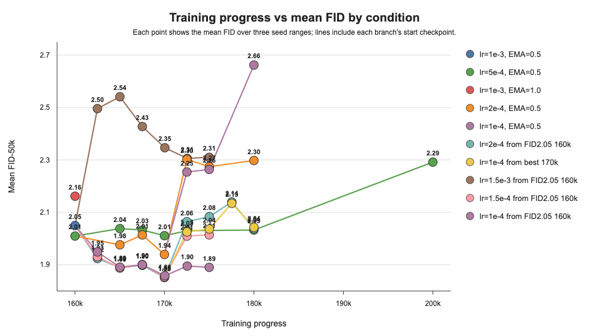

今回は、160k以降で学習率を変えた追加実験の結果を説明します。
青枠の2本は、どちらもFIDが約2.05の160k checkpointから、小さい学習率でさらに学習した結果です。
どちらも、160kから170kあたりまではFIDが下がり、最良の lr=0.0002 に近い結果まで改善しました。
しかし、170kを超えて学習を続けると、FIDはまた上がりました。つまり、小さい学習率でも170kあたりまでは良くなりますが、175kまで続ければさらに良くなるわけではありません。
ただ、lr=1e-4 では、170k以降のFIDの上がり幅は比較的小さいため、まだ近い良い領域にいる可能性があると考えています。現在は、学習率をさらに半分にして、そこからFIDがもう一度下がるかを確認しています。
