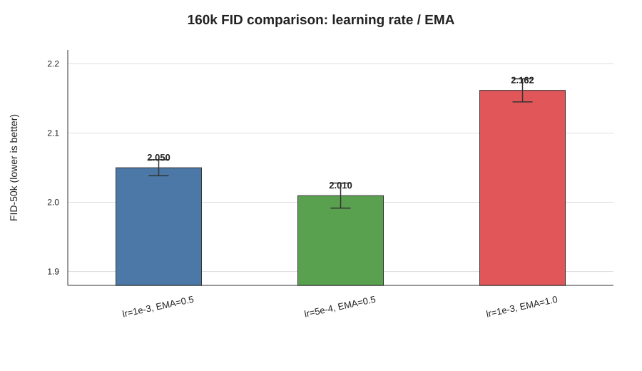
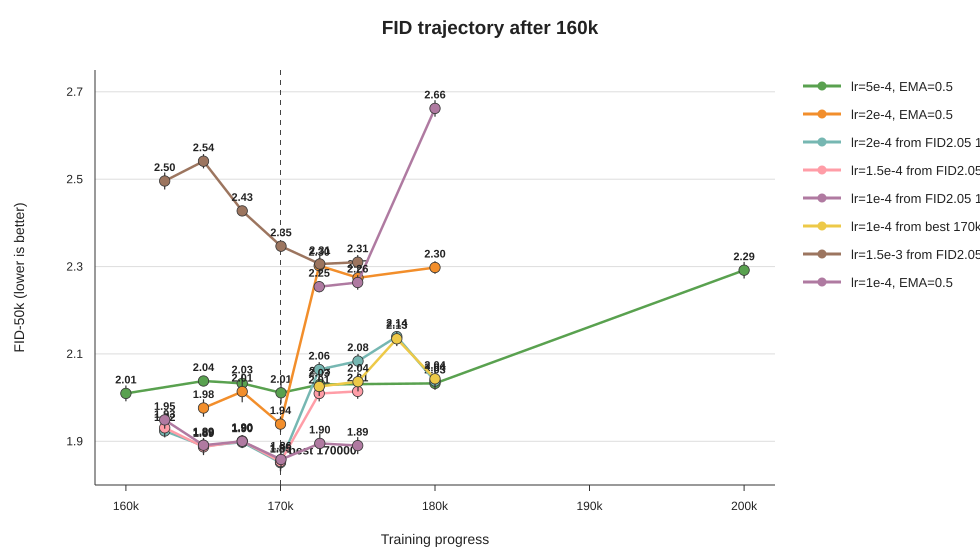

# EDM CIFAR-10 class-conditional における 120k以降のFID挙動解析

## ゼミ説明用レポート: lr/EMA分岐実験とFID推移

### 目的

120k以降でFIDが悪化する傾向があったため、120k checkpointを起点として learning rate と EMA half-life を変更し、FIDの挙動を確認した。

確認した主な点は次の3つである。

1. 120k->160kで、学習率を下げるとFIDが改善するか
2. EMA half-lifeを長くするとFIDが改善するか
3. 改善した条件でさらに学習を続けると、FID改善が継続するか

## 結果1: 120k->160kでは lr=0.0005 が有効

120kから160kまでの比較では、元設定 `lr=0.001, EMA=0.5` に対して、`lr=0.0005, EMA=0.5` がFIDを改善した。

| 条件 | 160k FID平均 | 標準偏差 | 解釈 |
|---|---:|---:|---|
| lr=0.001, EMA=0.5 | 2.04986 | 0.01155 | 元設定の再現 |
| lr=0.0005, EMA=0.5 | 2.00962 | 0.01808 | 改善 |
| lr=0.001, EMA=1.0 | 2.16162 | 0.01665 | 悪化 |

学習率を `0.001` から `0.0005` に下げるとFID平均が約0.040改善した。一方で、EMA half-lifeを `0.5` から `1.0` に伸ばすとFIDは悪化した。

## 結果2: 160k以降は lr=0.0002 の170kが最良

160k以降では、`lr=0.0005` のまま200kまで継続しても改善は続かなかった。そこで、160kから `lr=0.0002, EMA=0.5` に下げて170kまで学習したところ、FID平均 `1.93936` となり、今回の実験内で最良となった。

| 条件 | 評価時点 | FID平均 | 標準偏差 |
|---|---:|---:|---:|
| lr=0.0005, EMA=0.5 | 160k | 2.00962 | 0.01808 |
| lr=0.0005, EMA=0.5 | 約170k | 2.01113 | 0.02473 |
| lr=0.0002, EMA=0.5 | 170k | 1.93936 | 0.01749 |
| lr=0.0005, EMA=0.5 | 180k | 2.03250 | 0.01470 |
| lr=0.0005, EMA=0.5 | 200k | 2.29175 | 0.01899 |

170k付近で比較すると、`lr=0.0002` は `lr=0.0005` よりFID平均で約0.072良かった。

## 結果3: 170k以降に継続するとFIDは悪化

170kで改善したcheckpointを起点として、さらに学習を継続した。しかし、`lr=0.0002` のままでも、`lr=0.0001` に下げても、175k/180kではFIDが悪化した。

| 条件 | 評価時点 | FID平均 | 標準偏差 |
|---|---:|---:|---:|
| lr=0.0002, EMA=0.5 | 170k | 1.93936 | 0.01749 |
| lr=0.0002, EMA=0.5 | 約175k | 2.27436 | 0.02359 |
| lr=0.0002, EMA=0.5 | 180k | 2.29788 | 0.01450 |
| lr=0.0001, EMA=0.5 | 175k | 2.26355 | 0.01660 |
| lr=0.0001, EMA=0.5 | 180k | 2.66206 | 0.01885 |

lossは170k以降も低下していたが、FIDは悪化した。したがって、この範囲では学習lossと生成品質が乖離しており、lossだけを見て学習継続を判断するのは危険である。

## 結論

今回の実験では、最良のcheckpointは `lr=0.0002, EMA=0.5` で160kから170kまで継続したものだった。

現時点の解釈は以下の通り。

1. 120k以降は学習率を下げることでFIDが改善した。
2. EMA half-lifeを長くする設定は今回の範囲では有効ではなかった。
3. 170k以降は、lossが下がってもFIDが悪化した。
4. そのため、現時点では170k付近でearly stoppingするのが良い候補である。

## 今後の確認案

追加で確認するなら、170k以降を長く伸ばすより、160k->170kの間を細かく見る方が有効と考えられる。例えば、165k、168k、170k付近でFIDを確認し、FIDが最小になる時点をより正確に特定する。

`lr=0.00005, EMA=0.5` の170k->180k実験は準備済みだが、`lr=0.0002` と `lr=0.0001` の結果から、170k以降で大きく改善する可能性は高くないと考えている。

## 発表時の説明メモ

まず、図1で「160k時点では学習率を下げるのが有効で、EMAを長くするのは悪化した」と説明する。

次に、図2で「160kからさらに `lr=0.0002` に下げた170kが最良だったが、それ以降は継続してもFIDが悪化した」と説明する。

最後に、「lossは下がっているがFIDは悪化しているため、今回の設定ではFIDでcheckpoint選択する必要があり、170k付近のearly stoppingが有力」とまとめる。
