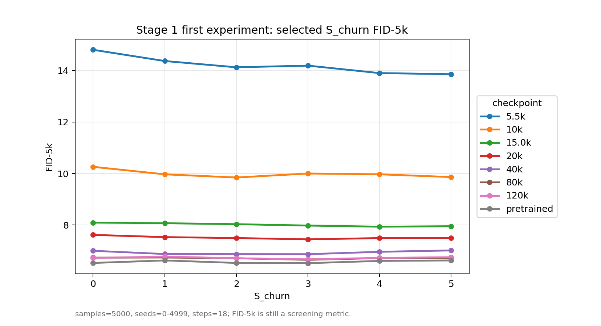
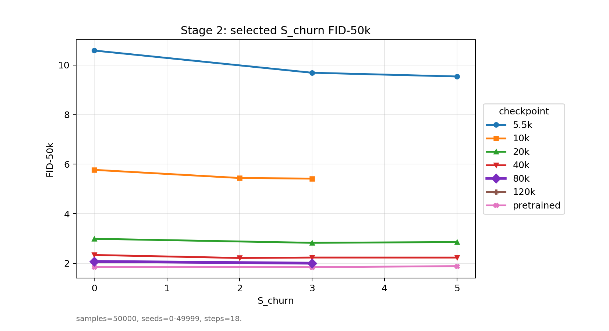
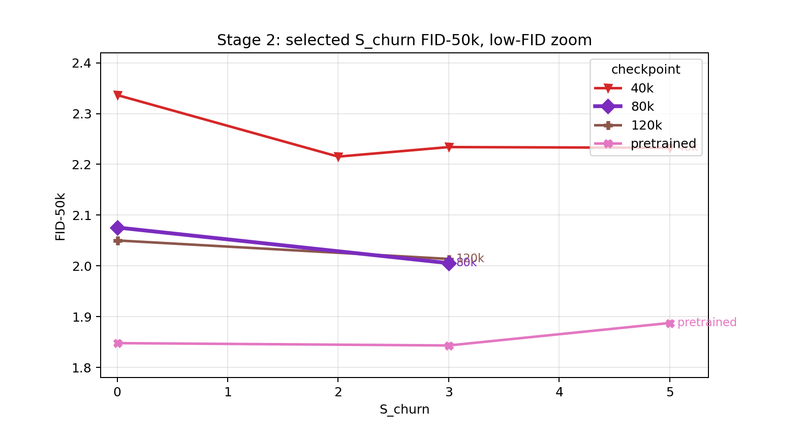
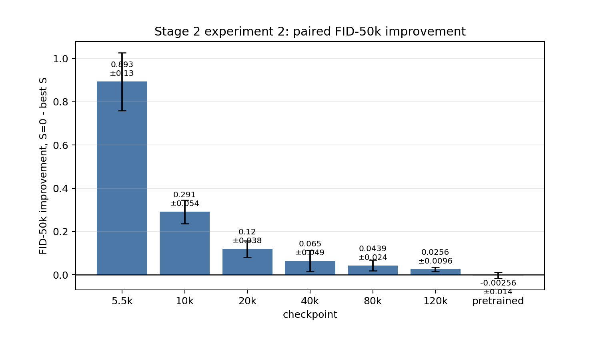

# EDM CIFAR-10 class-conditional における `S_churn` 感度解析

FID-5k/50k と 3 seed 平均による初回報告

EDM CIFAR-10 class-conditional の再現実験に関連して、サンプリング時の `S_churn` が checkpoint ごとの生成品質に与える影響を調べる追加実験を行いましたので、ご報告いたします。

今回の目的は、学習途中の checkpoint では `S_churn` のような確率的sampling設定がFIDに与える影響が大きく、十分訓練された pretrained model ではその影響が小さくなるかを確認することです。

各実験の実行時間は以下の通りです。いずれも画像生成とFID計算を含む時間です。

| 実験                             | 条件数 |    評価画像数 |     実行時間 |
| -------------------------------- | -----: | ------------: | -----------: |
| Stage 1 / FID-5k スクリーニング  | 48条件 |  5,000枚/条件 |  約8時間48分 |
| Stage 2-1 / FID-50k 代表条件確認 | 20条件 | 50,000枚/条件 | 約24時間57分 |
| Stage 2-2 / 追加2 seed範囲       | 28条件 | 50,000枚/条件 |  約35時間5分 |

## 実験1: Stage 1 / FID-5k による広めのスクリーニング

まず、FID-5kで粗く `S_churn` の感度を確認しました。

設定は以下です。

- dataset: CIFAR-10 32x32 class-conditional
- sampler: EDM sampler
- steps: 18
- seeds: 0-4999
- num images: 5000
- S_min=0, S_max=inf, S_noise=1
- checkpoint: 5.5k, 10k, 15.0k, 20k, 40k, 80k, 120k, pretrained
- S_churn: 0,1,2,3,4,5
- 条件数: 48条件
- 実行時間: 約8時間48分

結果として、低kimg側ほど `S_churn` によるFID改善が大きく、学習が進むにつれて改善幅が小さくなる傾向が見えました。代表的には以下のような結果でした。

| checkpoint | best S_churn | S=0 FID-5k | best FID-5k | 改善幅 |
| ---------- | -----------: | ---------: | ----------: | -----: |
| 5.5k       |            5 |    14.8097 |     13.8606 | 0.9491 |
| 10k        |            2 |    10.2602 |      9.8452 | 0.4150 |
| 20k        |            3 |     7.6149 |      7.4403 | 0.1746 |
| 40k        |            3 |     6.9962 |      6.8641 | 0.1321 |
| 80k        |            3 |     6.7304 |      6.6451 | 0.0853 |
| 120k       |            3 |     6.7141 |      6.6658 | 0.0482 |
| pretrained |            3 |     6.5234 |      6.5149 | 0.0086 |

この段階ではFID-5kなので絶対値としては不安定ですが、相対傾向としては「低学習checkpointほど `S_churn` の影響が大きい」可能性が見えました。

添付図: `fig1_stage1_fid5k_s_churn_sweep.png`



## 実験2: Stage 2-1 / FID-50k による代表条件の確認

次に、Stage 1で有望だった条件をFID-50kで確認しました。

設定は以下です。

- seeds: 0-49999
- num images: 50000
- steps: 18
- S_min=0, S_max=inf, S_noise=1
- 条件数: 20条件
- 実行時間: 約24時間57分

条件は以下のように絞りました。

| checkpoint | S_churn |
| ---------- | ------- |
| 5.5k       | 0,3,5   |
| 10k        | 0,2,3   |
| 20k        | 0,3,5   |
| 40k        | 0,2,3,5 |
| 80k        | 0,3     |
| 120k       | 0,3     |
| pretrained | 0,3,5   |

FID-50kでも、FID-5kで見えた傾向は概ね再現されました。

| checkpoint | S=0 FID-50k | best S_churn | best FID-50k | 改善幅 |
| ---------- | ----------: | -----------: | -----------: | -----: |
| 5.5k       |     10.5849 |            5 |       9.5387 | 1.0462 |
| 10k        |      5.7708 |            3 |       5.4177 | 0.3531 |
| 20k        |      2.9897 |            3 |       2.8271 | 0.1626 |
| 40k        |      2.3366 |            2 |       2.2152 | 0.1213 |
| 80k        |      2.0756 |            3 |       2.0054 | 0.0702 |
| 120k       |      2.0501 |            3 |       2.0137 | 0.0365 |
| pretrained |      1.8478 |            3 |       1.8432 | 0.0046 |

特に 5.5k, 10k, 20k では明確な改善が見られました。一方で pretrained では改善幅が 0.0046 と非常に小さく、`S_churn=5` ではむしろ FID=1.8875 まで悪化しました。

また、単一seed範囲では `80k, S_churn=3` が FID=2.0054 と、`120k, S_churn=3` の FID=2.0137 よりわずかに良い値でした。ただし差が小さいため、後述の追加seedで確認しました。





## 実験3: Stage 2-2 / 追加2 seed範囲による3 seed平均の確認

最後に、代表ペアに対して追加の2 seed範囲を評価しました。

追加したseed範囲は以下です。

- 50000-99999
- 100000-149999

追加条件数は28条件で、実行時間は約35時間5分でした。

既存の 0-49999 と合わせて、3 seed範囲で `mean ± std` を計算しました。評価対象は各checkpointについて `S_churn=0` と、Stage 2-1で選んだ代表的なbest `S_churn` のペアです。

改善幅は、同じseed範囲内で

```text
improvement = FID(S_churn=0) - FID(best S_churn)
```

として計算し、その平均と標準偏差を出しています。

3 seed平均の結果は以下です。

| checkpoint |       S=0 FID-50k | best S_churn |   best S FID-50k |            改善幅 |
| ---------- | ----------------: | -----------: | ---------------: | ----------------: |
| 5.5k       | 10.4855 ± 0.0865 |            5 | 9.5926 ± 0.0470 |  0.8930 ± 0.1335 |
| 10k        |  5.7319 ± 0.0338 |            3 | 5.4406 ± 0.0226 |  0.2912 ± 0.0542 |
| 20k        |  2.9622 ± 0.0240 |            3 | 2.8424 ± 0.0176 |  0.1198 ± 0.0381 |
| 40k        |  2.3037 ± 0.0291 |            2 | 2.2387 ± 0.0223 |  0.0650 ± 0.0489 |
| 80k        |  2.0557 ± 0.0175 |            3 | 2.0118 ± 0.0074 |  0.0439 ± 0.0241 |
| 120k       |  2.0300 ± 0.0179 |            3 | 2.0044 ± 0.0084 |  0.0256 ± 0.0096 |
| pretrained |  1.8391 ± 0.0141 |            3 | 1.8416 ± 0.0017 | -0.0026 ± 0.0144 |

3 seed平均でも、学習初期の checkpoint ほど `S_churn` による改善が大きく、学習が進むにつれて改善幅が小さくなる傾向が残りました。

一方で pretrained では平均改善幅が -0.0026 ± 0.0144 となり、`S_churn` による改善は確認できませんでした。むしろseedによっては悪化しており、十分訓練されたモデルでは `S_churn` の効果はほぼノイズレベルと考えています。

また、Stage 2-1の単一seedでは 80k が 120k よりわずかに良かったのですが、3 seed平均では以下のようになりました。

| checkpoint | S_churn=3 FID-50k |
| ---------- | ----------------: |
| 80k        |  2.0118 ± 0.0074 |
| 120k       |  2.0044 ± 0.0084 |

そのため、自前checkpoint内では 120k + S_churn=3 が平均的には最良でした。ただし80kとの差は小さく、checkpoint間の差よりもsampling設定の影響が無視できないことは確認できたと考えています。

添付図: `fig4_stage2_exp2_fid50k_3seed_paired_improvement.png`



## 現時点での解釈

今回の結果から、少なくともEDM CIFAR-10 class-conditional の学習途中checkpointにおいては、`S_churn` の影響はモデルの学習段階に依存しているように見えます。

具体的には、

- 低kimg checkpointでは `S_churn` によってFIDが明確に改善する。
- 学習が進むにつれて改善幅は小さくなる。
- pretrained modelでは `S_churn` の改善はほぼ見られない。

という傾向でした。

この結果は、十分訓練されたモデルではsampling solverや離散化誤差の影響が主に議論される一方で、学習途中または低リソース条件のモデルでは、モデル誤差や予測の不安定性とsampling hyperparameterの相互作用がより強く出る可能性を示していると考えています。

今後は、この結果をもとに、

1. `S_churn` の効果を checkpoint の学習進行やFID改善幅として整理する。
2. 画像サンプルや破綻例があるかを確認する。
3. 可能であれば、prediction inconsistency や1 full step vs 2 half stepsの不一致などの診断量との相関を見る。

という方向で進めたいと考えています。

ご確認いただけますと幸いです。

よろしくお願いいたします。
