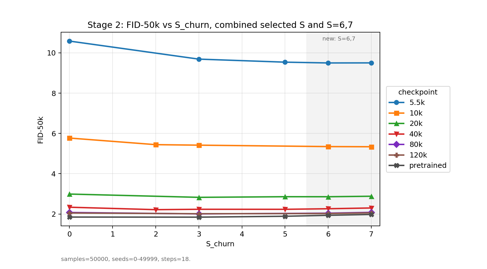
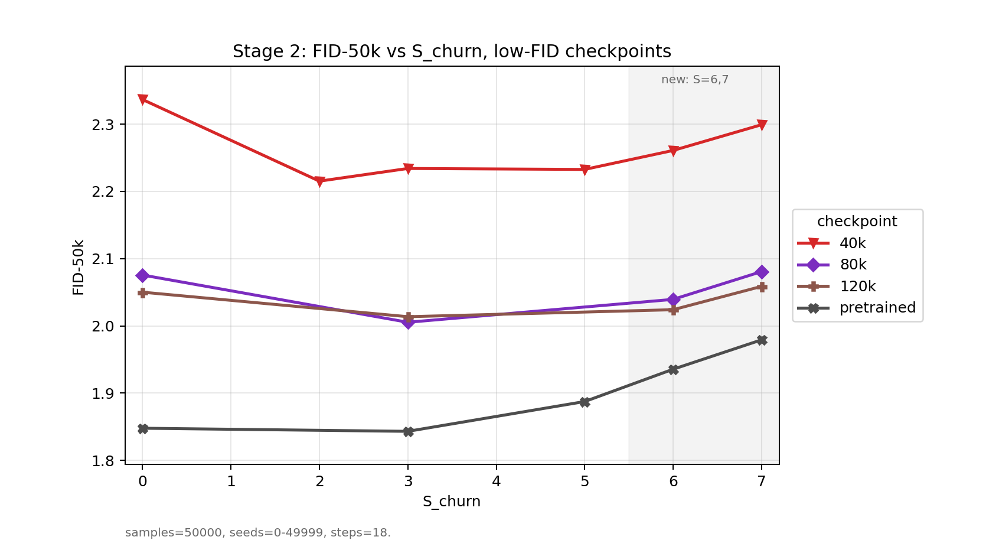

# EDM CIFAR-10 class-conditional における `S_churn` 感度解析

## 目的

前回では、主に `S_churn=0-5` の結果から、低 kimg checkpoint ほど `S_churn` による FID 改善が大きく、pretrained model では効果がほぼ見られないことを報告した。今回はその追加確認として、FID-50k で `S_churn=6,7` を評価した。

## 結果

低 kimg の `5.5k` と `10k` では前回の範囲より大きい `S_churn` でさらに FID が下がった。一方で、20k 以降および pretrained では前回の結論から大きな変更はなかった。

## 結果図

`S_churn=6,7` を追加し、既存の Stage 2-1 結果と結合した FID-50k 曲線を以下に示す。

低 FID 側を拡大した図では、20k 以降では `S_churn=6,7` が最良にはならず、pretrained ではむしろ悪化していることが分かる。

## 今後の確認

未成熟 checkpoint では sampler の設計が生成品質に影響する可能性が見えた。次の確認として、PNDM のような他の sampling 手法を EDM の枠組みに移植し、`S_churn` 調整と同様に低 kimg checkpoint の FID を改善できるかを調べて良い？
