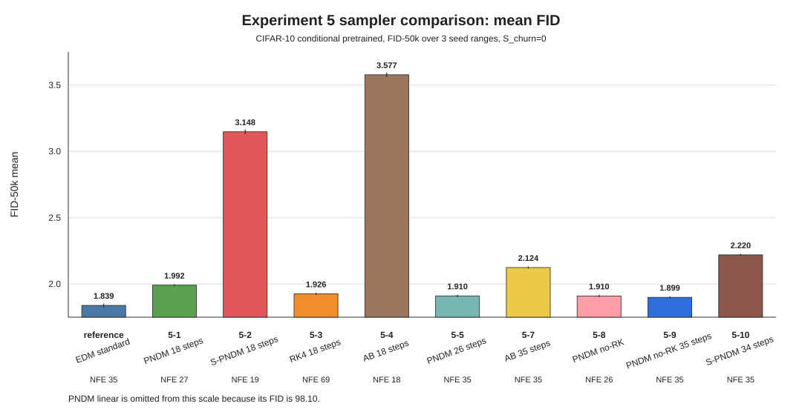
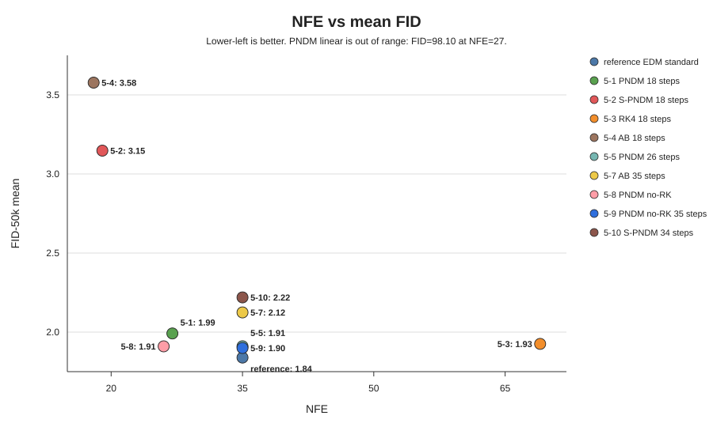

# EDM CIFAR-10 class-conditional pretrained における sampler 比較

公式Pretrainedモデルに対して、PNDM、RK、ABの sampler を移植・変更し、FID-50kを3つのseed範囲で評価した。条件はすべて `S_churn=0`、CIFAR-10 class-conditional、画像数は各seed範囲で50000枚である。

追加samplerの中では `PNDM no-RK 35 steps / 35 NFE` が FID平均 `1.89947` で最良だった。EDM標準の `1.83906` には届いていないが、RK4の `1.92574 / 69 NFE` より少ないNFEで良い結果となった。

PNDM系では、`18 steps / 27 NFE` の FID平均 `1.99152` から、`26 steps / 35 NFE` に増やすと `1.91047` まで改善した。RK warmupを外した `PNDM no-RK` は、`26 steps / 26 NFE` で `1.91000`、`35 steps / 35 NFE` で `1.89947` となった。RK warmupよりもstep数を増やす効果の方が大きいと考えられる。

S-PNDMは、NFEを `19` から `35` に増やすと FID平均が `3.14766` から `2.21971` まで改善した。Adams-Bashforthも、NFEを `18` から `35` に増やすと `3.57748` から `2.12443` まで改善した。ただし、どちらもPNDM系やRK4には届いていない。また、PNDMでlinear sigma scheduleにした条件は FID平均 `98.1024` まで悪化し、EDM rho scheduleが重要であることが分かった。

## 結果図

| 実験      | sampler     | schedule / 変更点        | steps | NFE | FID平均 |     std | まとめ                         |
| --------- | ----------- | ------------------------ | ----: | --: | ------: | ------: | ------------------------------ |
| reference | EDM標準     | EDM rho + Heun           |    18 |  35 | 1.83906 | 0.01411 | 比較基準、最良                 |
| 5-1       | PNDM        | EDM rho + RK warmup      |    18 |  27 | 1.99152 | 0.00708 | 追加samplerの初期PNDM          |
| 5-2       | S-PNDM      | EDM rho + 初回Heun + AB2 |    18 |  19 | 3.14766 | 0.01782 | 大きく悪化                     |
| 5-3       | RK4         | EDM rho + RK4            |    18 |  69 | 1.92574 | 0.00804 | 良好だがNFEが大きい            |
| 5-4       | AB          | EDM rho + AB             |    18 |  18 | 3.57748 | 0.01666 | 低NFEだが悪化                  |
| 5-5       | PNDM        | EDM rho + RK warmup      |    26 |  35 | 1.91047 | 0.00871 | PNDMはstep数を増やすと改善     |
| 5-6       | PNDM-linear | linear sigma schedule    |    18 |  27 | 98.1024 | 0.18795 | schedule変更で大きく失敗       |
| 5-7       | AB          | EDM rho + AB             |    35 |  35 | 2.12443 | 0.00789 | NFEを増やすと改善するが不十分  |
| 5-8       | PNDM no-RK  | EDM rho + no RK warmup   |    26 |  26 | 1.91000 | 0.00872 | RK warmupなしでも5-5とほぼ同等 |
| 5-9       | PNDM no-RK  | EDM rho + no RK warmup   |    35 |  35 | 1.89947 | 0.00806 | 追加sampler中で最良            |
| 5-10      | S-PNDM      | EDM rho + 初回Heun + AB2 |    34 |  35 | 2.21971 | 0.00691 | NFE増加で改善したが不十分      |

## 今後の確認

現状では、`PNDM no-RK` が追加sampler中で最も良く、step数を増やすとさらに改善した。次は35 steps付近でstep数を変え、改善が続くかを確認する。また、EDM標準との差が更新式によるものか、sigma scheduleによるものかを切り分ける。
