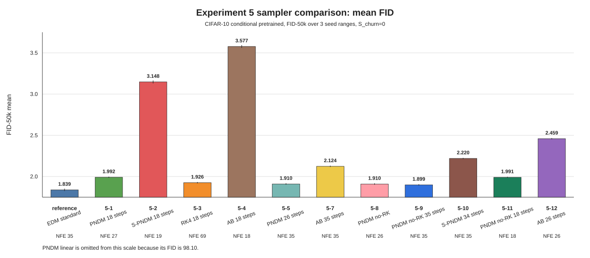
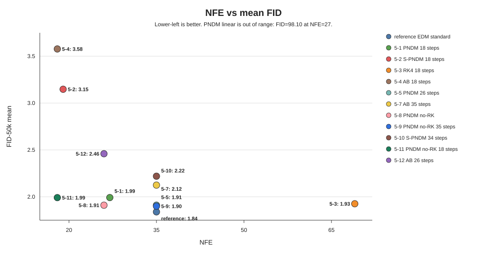

# EDM CIFAR-10 class-conditional pretrained における sampler 比較

## AB係数とNFEによるFIDの変化

## 要旨

公式Pretrainedモデルに対して、PNDM、RK、ABのsamplerを移植・変更し、FID-50kを3つのseed範囲で評価した。条件はすべて `S_churn=0`、CIFAR-10 class-conditional、画像数は各seed範囲で50000枚である。

追加samplerの中では、`PNDM no-RK 35 steps / 35 NFE` がFID平均 `1.89947` で最良だった。EDM標準の `1.83906` には届いていないが、RK4の `1.92574 / 69 NFE` より少ないNFEで良い結果となった。

実験11では、固定係数の `PNDM no-RK` を `18 NFE` で評価し、FID平均は `1.99106` だった。同じ18 NFEの可変係数AB（実験4、`3.57748`）より大幅に良かった。また、RK warmupありのPNDM（実験1、`1.99152 / 27 NFE`）とほぼ同じFIDを、9 NFE少なく達成した。

実験12では、可変係数ABを `26 NFE` で評価し、FID平均は `2.45947` だった。同じ26 NFEの固定係数PNDM no-RK（実験8、`1.91000`）には届かなかった。今回の条件では、EDM rho scheduleに合わせた可変係数より、等間隔用の固定係数の方が良い結果となった。

## 結果図

| 実験 | sampler | schedule / 変更点 | steps | NFE | FID平均 | std | まとめ |
|---|---|---|---:|---:|---:|---:|---|
| reference | EDM標準 | EDM rho + Heun | 18 | 35 | 1.83906 | 0.01411 | 比較基準、最良 |
| 5-1 | PNDM | EDM rho + RK warmup | 18 | 27 | 1.99152 | 0.00708 | 初期PNDM |
| 5-2 | S-PNDM | EDM rho + 初回Heun + AB2 | 18 | 19 | 3.14766 | 0.01782 | 大きく悪化 |
| 5-3 | RK4 | EDM rho + RK4 | 18 | 69 | 1.92574 | 0.00804 | 良好だがNFEが大きい |
| 5-4 | AB | EDM rho + 可変係数AB | 18 | 18 | 3.57748 | 0.01666 | 5-11より悪い |
| 5-5 | PNDM | EDM rho + RK warmup | 26 | 35 | 1.91047 | 0.00871 | step数の増加で改善 |
| 5-6 | PNDM-linear | linear sigma schedule | 18 | 27 | 98.1024 | 0.18795 | schedule変更で大きく失敗 |
| 5-7 | AB | EDM rho + 可変係数AB | 35 | 35 | 2.12443 | 0.00789 | NFE増加で改善 |
| 5-8 | PNDM no-RK | EDM rho + 固定係数AB | 26 | 26 | 1.91000 | 0.00872 | 5-12より良い |
| 5-9 | PNDM no-RK | EDM rho + 固定係数AB | 35 | 35 | 1.89947 | 0.00806 | 追加sampler中で最良 |
| 5-10 | S-PNDM | EDM rho + 初回Heun + AB2 | 34 | 35 | 2.21971 | 0.00691 | NFE増加で改善 |
| 5-11 | PNDM no-RK | EDM rho + 固定係数AB | 18 | 18 | 1.99106 | 0.00635 | 同NFEの5-4より良い |
| 5-12 | AB | EDM rho + 可変係数AB | 26 | 26 | 2.45947 | 0.00721 | 同NFEの5-8より悪い |

## 係数確認の目的

可変係数ABはNFEを増やすと改善したが、同じNFEの固定係数PNDM no-RKには届かなかった。そこで可変係数ABの係数計算と微分履歴の扱いを確認し、この差が実装によるものか、更新方法そのものによるものかを調べた。

## 5-4と5-11のstep別係数

18 stepsのsigma列から、5-4と5-11が各更新で使用するAB係数を比較した。最初の
Euler stepは同一だが、AB2以降は不等間隔のrho scheduleによって係数が異なる。
最初のAB4では、現在から過去への正規化重みが次のようになった。

| 実験 | step 4の重み `[f_i, f_{i-1}, f_{i-2}, f_{i-3}]` |
|---|---|
| 5-4 可変係数 | `[1.7503, -1.1227, 0.4374, -0.0650]` |
| 5-11 固定係数 | `[2.2917, -2.4583, 1.5417, -0.3750]` |

最終stepでは5-4が`[1.2630, -0.2957, 0.0341, -0.0014]`まで現在の微分中心に
変化する一方、5-11は固定AB4重みを維持する。したがって5-11は、特に低ノイズ側で
5-4より古い微分を強く使う外挿になっている。

全stepのsigma区間、正規化重み、実際に微分へ掛かる更新係数は
[5-4と5-11のAdams-Bashforth係数比較](2026-09-01_ab_coefficients_5-4_vs_5-11.md)にまとめた。

## 今後の確認

係数計算は`generate.py`の実装と同じLagrange補間の積分から再現でき、5-4と5-11の
差が実際の更新係数に現れることを確認した。次は高精度HeunまたはRKの参照軌道に対する
各samplerの距離を測り、固定係数が数値解から離れながらFIDを改善しているかを確認する。
