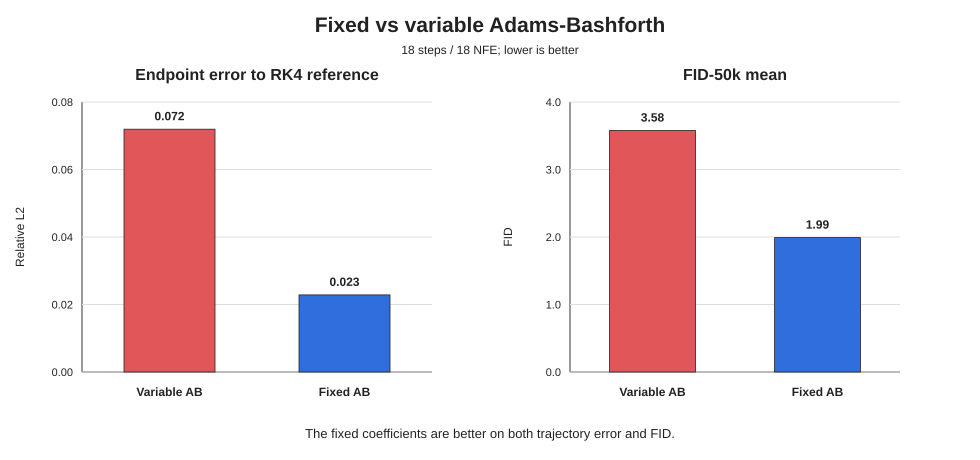
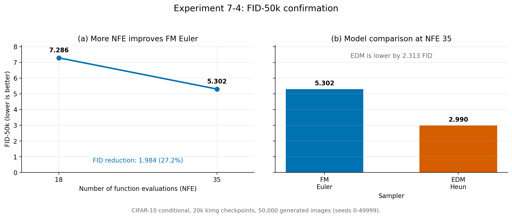
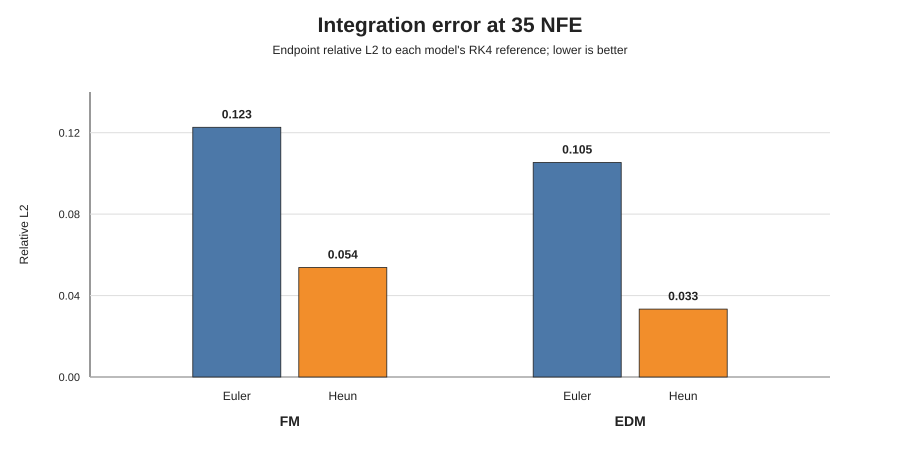
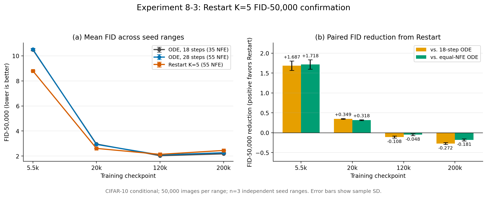

# AB軌道解析・Linear Flow Matching・Restart Sampling

samplerのFID差を軌道誤差から調べ、Linear Flow Matching（FM）とRestart Samplingの実験をやってみた。

- 固定係数ABは、可変係数ABよりFIDが良いだけでなく、高精度参照軌道にも近かった。
- Linear FMは20kまで学習でき、NFEを増やすとFIDが改善した。ただし、同じ20k・35 NFEではEDMの方が良かった。
- Restartは学習初期のcheckpointを改善したが、学習後期では逆にFIDを悪化させた。

| 実験             | 確認したこと                                    |
| ---------------- | ----------------------------------------------- |
| AB軌道解析       | 固定係数ABと可変係数ABの参照軌道からの距離      |
| Linear FM        | 20k学習、solver・NFE・EDMとの比較               |
| Restart Sampling | checkpointごとの効果をFID-50k・3 seed範囲で確認 |

## 1. AB軌道解析

### 実験条件

| 項目        | 条件                                                |
| ----------- | --------------------------------------------------- |
| model       | 公式EDM CIFAR-10 class-conditional pretrained       |
| 比較        | 可変係数AB（実験5-4）／固定係数AB（実験5-11）       |
| schedule    | EDM rho schedule、`rho=7`、`sigma: 80 → 0.002` |
| steps / NFE | 18 / 18                                             |
| seeds       | `0-1023`                                          |
| 参照解      | RK4、各区間8分割                                    |
| sampling    | `S_churn=0`                                       |

### 実験結果

| 手法                |    最終相対L2誤差 |       FID-50k平均 |
| ------------------- | ----------------: | ----------------: |
| 可変係数AB          |           0.07195 |           3.57748 |
| 固定係数AB          | **0.02286** | **1.99106** |
| RK4参照解の収束誤差 |         0.0000119 |                 - |

固定係数ABは、可変係数ABの約3分の1の軌道誤差となり、FIDも良かった。したがって、今回のFID差は「参照軌道から外れることで画質が良くなった」という仮説とは一致せず、固定係数ABの方が学習済みODEを正確に積分できた可能性が高い。

## 2. Linear Flow Matching

### 実験条件

| 項目                 | 条件                                        |
| -------------------- | ------------------------------------------- |
| dataset / model      | CIFAR-10 class-conditional、DDPM++          |
| path                 | `x_t = (1-t)z + ty`、independent coupling |
| prediction           | velocity`v = y-z`                         |
| training             | 20k kimg、batch 512、Adam、LR`0.001`      |
| EMA / regularization | EMA 0.5 Mimg、dropout 0.13、augment 0.12    |
| precision / seed     | FP32、seed 0                                |
| sampler              | FM Euler / FM Heun                          |

### 学習経過

FID-5kはFM Euler 18 NFE、seeds `0-4999`で評価した。

| 学習量 |    loss |            FID-5k |
| -----: | ------: | ----------------: |
|     1k | 0.18448 |           42.6155 |
|     3k | 0.17488 |           24.9348 |
|    10k | 0.16784 |           13.2718 |
|    20k | 0.16472 | **11.7926** |

学習量を増やすとlossとFIDは継続して改善し、20kまで学習が正常に進むことを確認した。

### NFEとFID

| model / sampler | 学習量 | NFE |           FID-50k |
| --------------- | -----: | --: | ----------------: |
| FM Euler        |    20k |  18 |           7.28617 |
| FM Euler        |    20k |  35 | **5.30242** |
| EDM Heun        |    20k |  35 | **2.98971** |

FMではNFEを18から35へ増やすと、FIDが`7.29 → 5.30`に改善した。一方、同じ20k・35 NFEではEDMが`2.99`であり、FMとの差は残った。

### 数値積分誤差

| model | solver | NFE | 参照解に対する最終相対L2誤差 |
| ----- | ------ | --: | ---------------------------: |
| FM    | Euler  |  35 |                      0.12265 |
| FM    | Heun   |  35 |                      0.05377 |
| EDM   | Euler  |  35 |                      0.10535 |
| EDM   | Heun   |  35 |            **0.03333** |

HeunはEulerより参照解に近く、EDM Heunが最も小さい誤差となった。ただしFMでは、参照解に近いHeunがFID-5kでEulerを上回らなかったため、FID差は積分誤差だけでなく、20k時点の学習誤差や学習された経路にも影響されていると考えられる。

## 3. Restart Sampling

### 実験条件

| 項目        | 条件                                                   |
| ----------- | ------------------------------------------------------ |
| model       | 自前EDMの5.5k／20k／120k／200k checkpoint              |
| baseline    | EDM Heun、18 steps / 35 NFE                            |
| Restart     | main 18 steps、`K=5`、`t_min=0.06`、`t_max=0.30` |
| Restart NFE | 55                                                     |
| 同NFE比較   | EDM Heun、28 steps / 55 NFE                            |
| 評価        | FID-50k、3 seed範囲、各50000枚                         |

Restartでは、低ノイズ領域へノイズを再注入し、同じ区間を再度denoiseする。単純なNFE増加との違いを見るため、55 NFEの通常ODEとも比較した。

### 実験結果

| checkpoint |   通常ODE 35 NFE | 通常ODE 55 NFE |   Restart 55 NFE | 同NFE ODEからの改善 |
| ---------: | ---------------: | -------------: | ---------------: | ------------------: |
|       5.5k |          10.4855 |        10.5160 | **8.7981** |   **+1.7179** |
|        20k |           2.9621 |         2.9303 | **2.6127** |   **+0.3176** |
|       120k | **2.0300** |         2.0902 |           2.1384 |             -0.0483 |
|       200k | **2.1779** |         2.2688 |           2.4496 |             -0.1808 |

数値は3 seed範囲のFID平均で、正の改善値はRestartが良いことを表す。Restartは5.5kと20kでは一貫して改善したが、120kと200kでは全seed範囲で悪化した。学習不足modelでは再denoiseが誤差修正として働く一方、十分に学習したmodelでは追加ノイズが生成結果を崩す可能性がある。
