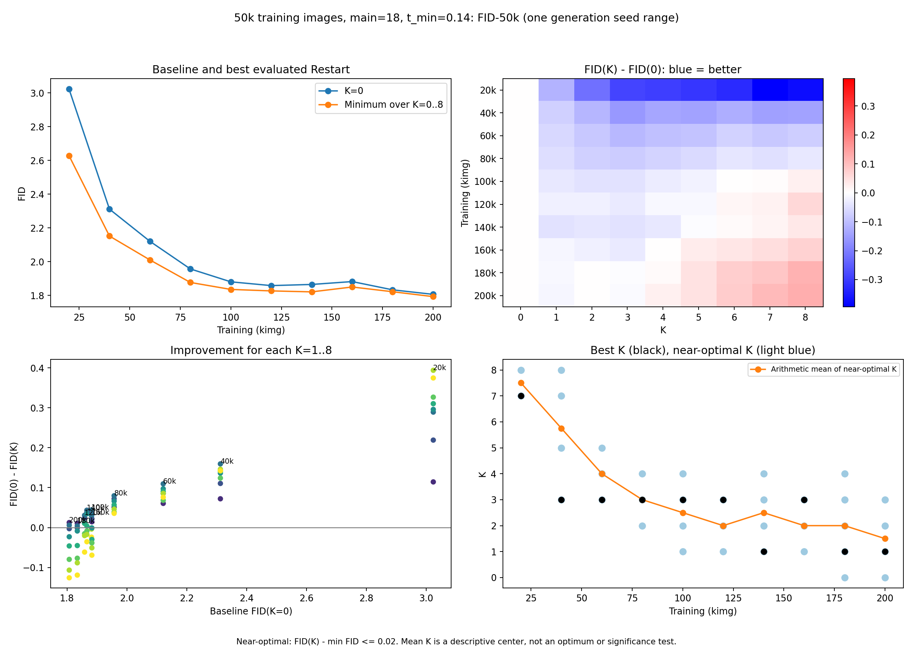
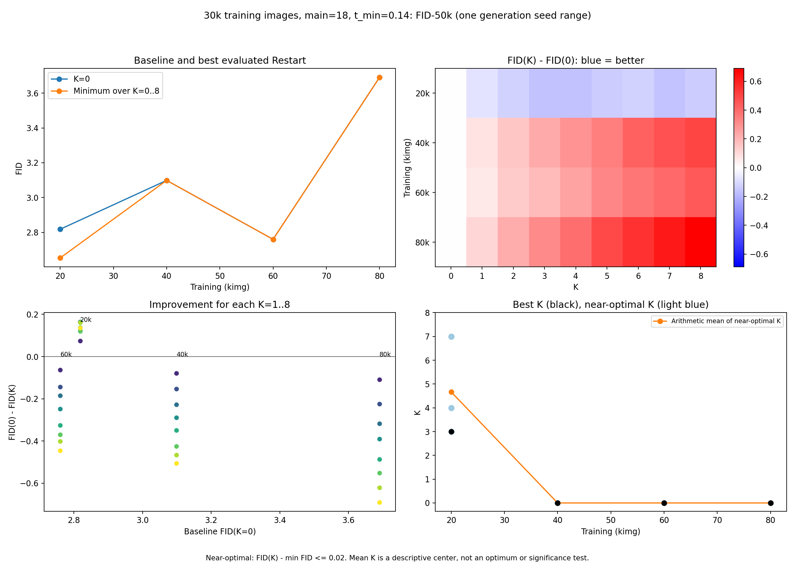
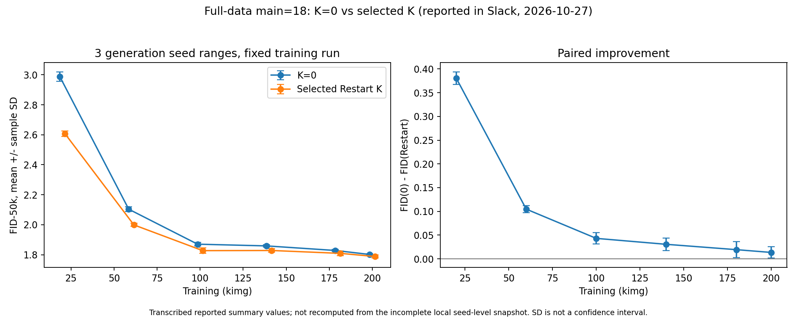

# 必要図と掲載案

全図をPNG/SVGで`figures/`に保存した。01〜05の数値は`data/`のローカル実測TSVスナップショット、06〜07はSlack報告値、08は既存ローカル図。Slack添付画像のダウンロード・同一性確認は行っていない。

## 図一覧

| 番号 | 図・用途 | 出典と扱い |
|---|---|---|
| 01 | [50k画像・N_main=18固定](figures/01_full_main18.png)：学習量–FID、改善ヒートマップ、baseline–改善幅、近傍Kと単純平均 | 8-11のFID-50k、90条件。主結果の掲載候補 |
| 02 | [50k画像・NFE=55固定](figures/02_full_nfe55.png)：01と同じ4パネル | 8-12のFID-50k、90条件。actual_t_min表とともに掲載 |
| 03 | [30k画像・N_main固定](figures/03_subset_main18.png)：Restart効果と学習量 | 8-14 main18。20k/40k/60k/80kのFID-50kのみ |
| 04 | [30k画像・NFE固定](figures/04_subset_nfe55.png)：固定計算量でのデータ不足結果 | 8-14 nfe55。20k/40k/60kのFID-50kのみ。未完了点を補完しない |
| 05 | [30k画像の学習軌跡](figures/05_subset30k_training.png)：学習不足とデータ不足の区別 | 0-2のK=0・FID-50k、10k〜100k。50k以降のFID悪化を確認 |
| 06 | [50k画像・3生成seedの確認](figures/06_full_3seeds.png)：K=0と選択Kの平均±SD、paired改善幅 | [10月27日報告表](https://kato-ai-lab.slack.com/archives/C082JD35X5W/p1793027847627969)から転記。6 checkpoint。100k/140kの元JSONは要同期 |
| 07 | [200k・210kの3生成seed](figures/07_post200k_3seeds.png)：十分学習したモデル／過学習的なモデルでの小さな改善 | [10月27日報告表](https://kato-ai-lab.slack.com/archives/C082JD35X5W/p1793028436537769)から転記。改善幅SDは未記載のため描かない |
| 08 | [t_min=0.06対0.14](figures/08_tmin_comparison.png)：主設定の選定理由 | 8-8の既存FID-50k図。発展的実験／Appendix候補 |

SVGは同名拡張子`.svg`。01〜04の数値表は`data/<図ファイル名>_stats.tsv`に保存した。06の200k baseline SDは元報告表の0.00470、07は別報告表の0.00469を保持している（丸め表記の違い）。

## 図の定義

**改善幅：** `I(K)=FID(K=0)−FID(K)`。正なら改善。baseline–改善幅散布図ではK=1〜8をすべて表示し、色をK（小さいKが紫、大きいKが黄）に対応させている。checkpoint注記は最良Kの位置。最良値だけで傾向を判定せず、同じKでの対応も確認する。

**差分ヒートマップ：** `D(K)=FID(K)−FID(K=0)`。負（青）が改善、正（赤）が悪化。改善幅散布図とは符号が反対。色範囲は各図内の最大絶対差を用いるため、図間の色の濃さだけで比較しない。

**近傍Kの単純平均：** 各checkpointの最小値を`f_min=min_K FID(K)`、`S={K | FID(K)−f_min <= 0.02}`として、`mean_K=(Σ_{K∈S}K)/|S|`。黒点が最良K、薄青点がS、オレンジ線が単純平均。最良値が同じ場合は小さいKを選ぶ。K=0〜8がすべて揃ったcheckpointだけ計算する。補間・移動平均・指数重み付けは行わない。閾値0.02は現行コードの表示上の許容幅であり、有意差や信頼区間を表すものではない。[11月2日の先生の選択](https://kato-ai-lab.slack.com/archives/C082JD35X5W/p1793628822297069)

**baselineと最良Restartの学習曲線：** 全Kの最小値を使う方針は[9月28日DM](https://kato-ai-lab.slack.com/archives/D08LCS5CPM3/p1790594348030149)に対応する。候補選択と評価に同じ生成seed集合を使うので、最小FIDには選択による楽観的な偏りがありうる。

**3生成seed：** SDは標本標準偏差。改善幅のSDは報告表にあるpaired差分のSDを使い、baselineとRestartのSDを単純に足したり独立と仮定して合成したりしない。学習seed間の変動・統計的有意差を示すものではない。N_main固定ではKによりNFEが増えるので、改善を同一計算量での優位と表現しない。

## 掲載時の優先順

本文は01・06を中心に、02とactual_t_min表、05と03〜04を配置する。07は200k以降の補足、08はパラメータ選定のAppendix候補。これは本整理での掲載案であり、先生から図の最終配置まで指定されたわけではない。実験8-10（t_min=0.06）と8-12（t_min=0.14）を取り違えない。

actual_t_minの数値表は[data/actual_tmin_nfe55.tsv](data/actual_tmin_nfe55.tsv)。10月12日DMの表に対応し、N_mainとNFEも併記している。K=0ではRestartがないためactual_t_min/indexは空欄。

## プレビュー

